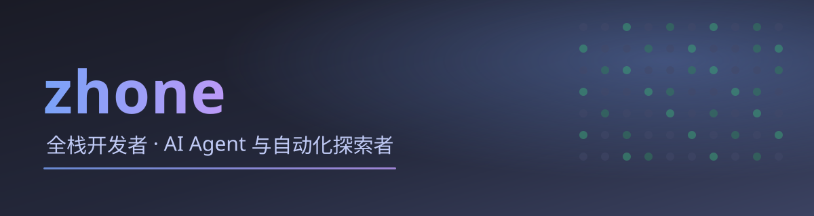

  

<h1 align="center">👋 你好，我是 zhone</h1>

<b>全栈开发者 · AI Agent 与自动化探索者</b>

---

<h2>👤 关于我</h2>

我是一名全栈开发者，专注于把 <b>AI / LLM</b> 能力封装成普通人也能轻松上手的实用工具。偏好<b>轻量、可自托管、低依赖</b>的技术方案，相信好的工具应当安静地帮人把事情做完。

---

<h2>🛠️ 技术栈</h2>

<b>🧩 语言</b>

  
  
  
  
  

<b>🗄️ 数据库 / 缓存 / 搜索</b>

  
  
  
  

<b>⚙️ 后端 / 中间件 / 运维</b>

  
  
  
  
  

<b>🤖 AI / 工具</b>

  

---

<h2>📌 当前关注</h2>

- 🤖 **Agent 的自托管与工具化落地** —— 让能力可被部署、被调用、被组合
- 🗣️ **自然语言交互** —— 把口语化的意图转换成可靠的自动化任务
- 🧰 **开发者友好的开源体验** —— 低门槛、可本地跑、文档清晰

---

<h2>🚀 精选项目</h2>

<table align="center">
  <tr>
    <td align="center"><b>项目</b></td>
    <td align="center"><b>简介</b></td>
    <td align="center"><b>技术栈</b></td>
    <td align="center"><b>入口</b></td>
  </tr>
  <tr>
    <td align="center"><b>alarm-agent</b></td>
    <td>中文自然语言定时能力平台：解析自然语言闹钟、托管定时任务、Webhook 投递与开发者门户</td>
    <td align="center">Node 22 · SQLite · Docker</td>
    <td align="center">
      
    </td>
  </tr>
</table>

🔜 更多项目陆续公开…

---

<h2>🐍 贡献活动</h2>

  

> 由 GitHub Actions 每日自动生成并提交至仓库，<b>不依赖任何第三方图床</b>，稳定加载。

---

<h2>🧭 快速导航</h2>

  
  
  

---

© 2026 zhone · Built with ☕ & 🐍

